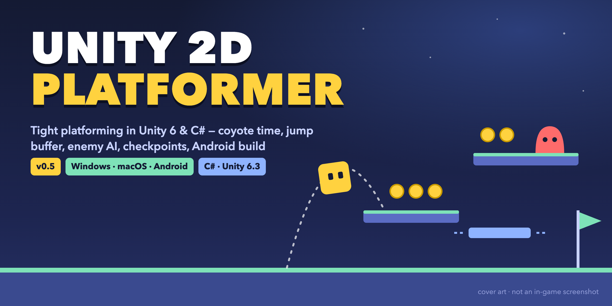

# Unity 2D Platformer



[](https://github.com/omerarkbua01/Unity-2D-Platformer/releases/latest)


A 2D platformer game built with Unity as part of a structured 7-month game development learning journey.
Targeting a junior Unity Developer position.

**▶ Play it:** download the latest build for Windows, macOS or Android from [Releases](https://github.com/omerarkbua01/Unity-2D-Platformer/releases/latest).

> The cover image is illustrative art, not an in-game screenshot.

## 🎮 Controls

### PC
| Key | Action |
|-----|--------|
| A / D | Move left / right |
| Space | Jump (hold for higher jump) |
| Escape | Pause |

### Mobile (Android)
| Button | Action |
|--------|--------|
| ◄ | Move left |
| ► | Move right |
| ▲ | Jump (hold for higher jump) |

## 🏆 Win / Lose Conditions

- **Win:** Collect all coins → Level Complete
- **Lose:** Health reaches 0 or fall into void → Game Over
- **Checkpoint:** Mid-level checkpoint saves respawn position

## ✅ Features

### Player
- Horizontal movement with air control
- Variable jump height (tap vs hold)
- Coyote time (0.2s grace period after leaving platform)
- Jump buffer (0.2s input memory for forgiving timing)
- Raycast ground detection
- Hit flash feedback on damage

### Enemy AI
- Idle / Patrol / Chase state machine
- Contact damage with cooldown
- Head stomp mechanic — jump on enemy to kill
- Bounce feedback on successful stomp

### Platformer Mechanics
- Moving platform with player carry system
- Fail zone — instant death on fall
- Checkpoint system — respawn at checkpoint after death

### Game Flow
- Game Over screen + restart
- Level Complete screen + restart
- Pause menu (ESC / Android back button)
- Pause / Game Over / Win conflict resolution

### UI
- Real-time health display + hit flash
- Real-time score display
- Debug HUD (F1 toggle) — velocity + grounded state
- Responsive UI (Scale With Screen Size)

### Audio / Visual
- Coin collect SFX
- Jump SFX
- Stomp SFX
- Coin collect VFX (particle)
- Jump VFX (particle)
- Stomp VFX (particle)

### Mobile
- On-screen left / right / jump controls
- EventTrigger-based hold input (basılı tutma desteği)
- Android back button → pause
- Canvas Scaler — multi-resolution support
- Android APK build

## 🛠️ Technical Details

- **Engine:** Unity 6.3 LTS
- **Language:** C#
- **Platform:** PC (Windows + macOS) + Android
- **Input:** New Input System (PC) + EventTrigger (Mobile)
- **Camera:** Cinemachine 3.x
- **Physics:** Rigidbody2D

## 📥 Downloads

| Platform | Version | Link |
|----------|---------|------|
| Windows | v0.5 | [Unity-2D-Platformer-Windows-v0.5.zip](https://github.com/omerarkbua01/Unity-2D-Platformer/releases/download/v0.5/Unity-2D-Platformer-Windows-v0.5.zip)  |
| macOS | v0.5 | [Unity-2D-Platformer-Mac-v0.5.zip](https://github.com/omerarkbua01/Unity-2D-Platformer/releases/download/v0.5/Unity-2D-Platformer-Mac-v0.5.zip)  |
| Android APK | v0.5 | [Platformer_MobileCheckpoint_v0.1.apk.zip](https://github.com/omerarkbua01/Unity-2D-Platformer/releases/download/v0.5/Platformer_MobileCheckpoint_v0.1.apk.zip)  |

> ⚠️ macOS: If blocked by Gatekeeper, right-click → Open

## 🏷️ Version History

| Version | Highlights |
|---------|------------|
| [v0.5](https://github.com/omerarkbua01/Unity-2D-Platformer/releases/tag/v0.5) | Mobile checkpoint — Android build + on-screen controls |
| [v0.4](https://github.com/omerarkbua01/Unity-2D-Platformer/releases/tag/v0.4) | Enemy AI + game flow + mini level |
| [v0.3](https://github.com/omerarkbua01/Unity-2D-Platformer/releases/tag/v0.3) | New Input System (move, jump, interact) |
| [v0.2](https://github.com/omerarkbua01/Unity-2D-Platformer/releases/tag/v0.2) | Coin system + pause menu + UI |
| [v0.1](https://github.com/omerarkbua01/Unity-2D-Platformer/releases/tag/v0.1) | Movement + jump + air control |

## 🚀 Development Progress

Following a structured 7-month Unity learning plan toward a Junior Unity Developer position.

### Month 1 — February ✅
- Unity setup, 2D basics, Git workflow
- Player movement, jump mechanics, Cinemachine
- Coin system, Score UI, Pause menu, Debug HUD

### Month 2 — March ✅
- New Input System
- Enemy idle / patrol / chase AI
- Contact damage, hit feedback
- Game Over + Level Complete flow
- Pause conflict resolution

### Month 3 — April ✅
- Fail zone, checkpoint system
- Moving platform with player carry
- Head stomp mechanic
- SFX + VFX feedback
- Polish pass
- **Mobile checkpoint: Android build + on-screen controls**

**Status:** v0.5 is the current playable milestone of this project.

## 📁 Project Structure

```
Assets/
├── Scripts/        # gameplay code — player, enemy AI, checkpoints, platforms, UI, game flow
├── Prefabs/        # Player, Coin, Obstacle and VFX prefabs
├── Scenes/         # SampleScene (the level)
├── Input/          # Input System action asset + generated PlayerControls
├── GameDefault/    # URP, volume and physics material defaults
├── Audio/          # SFX
└── PNG FOLDER/     # mobile control and UI sprites
```

## ▶️ How to Run

1. Install **Unity 6.3 (6000.3.7f1)** via Unity Hub
2. Clone the repository and open the folder in Unity Hub (**Add project from disk**)
3. Open `Assets/Scenes/SampleScene.unity` and press **Play**

## 👨‍💻 Developer

- **Developer:** Ömer F. Arıkbuğa
- **GitHub:** [@omerarkbua01](https://github.com/omerarkbua01)
- **Learning Plan:** v4.5 — 7-month Unity game development roadmap
